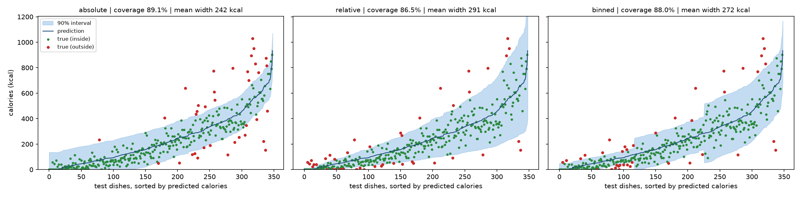
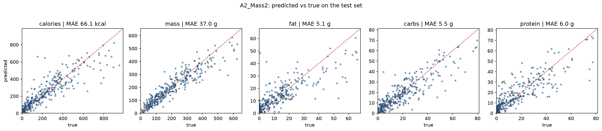

# NutriAgent: calories and macros from one food photo, with honest uncertainty

NutriAgent estimates the **calories, mass, fat, carbohydrates and protein** of a plate from a single overhead photo. It also gives a **range that contains the true value 90% of the time**, so the user knows how much to trust each number.

- **Model:** multitask ResNet18, fine-tuned in 3 stages on [Nutrition5k](https://github.com/google-research-datasets/Nutrition5k) (Google, CVPR 2021). It has 3,490 real cafeteria dishes weighed ingredient by ingredient.
- **Uncertainty:** *split conformal prediction*, which gives distribution-free intervals with a finite-sample coverage guarantee. Small, medium and large portions are calibrated separately (Mondrian conformal), so the 90% guarantee holds for small and large plates alike.
- **Demo:** Streamlit app: upload a photo, get the estimates and their ranges, optionally correct the portion mass.



## Results

Test set: 349 dishes never used for training or model selection. The table shows the MAE, with the MAE as a % of the mean true value in brackets.

| Model | Calories (kcal) | Mass (g) | Fat (g) | Carbs (g) | Protein (g) |
|---|---|---|---|---|---|
| Baseline: always predict the training mean | 176.9 (75%) | 118.0 (58%) | 11.1 (90%) | 13.4 (73%) | 14.8 (96%) |
| A1: frozen ResNet18 + multitask heads | 79.1 (34%) | 45.4 (22%) | 6.0 (49%) | 6.8 (37%) | 6.5 (42%) |
| A1_Phase2: + fine-tune `layer4` | 67.9 (29%) | 38.3 (19%) | 5.1 (42%) | 5.8 (31%) | 6.2 (40%) |
| **A2_Mass2: + mass loss ×2** | **66.1 (28%)** | **37.0 (18%)** | **5.1 (41%)** | **5.5 (30%)** | **6.0 (39%)** |

- The final model **cuts calorie error by 63%** compared with the mean baseline (66 vs 177 kcal).
- Giving the **mass loss twice the weight** helps every nutrient, not only mass. Portion size is the main driver of total nutrients.
- **Reference point:** the Nutrition5k paper's RGB-only "direct prediction" baseline (Inception-v3) reports 70.6 kcal MAE. This is *not* a like-for-like comparison: that number uses the official split, and this repo uses a random 80/10/10 split by dish.



### Uncertainty: are the 90% ranges honest?

Three ways to build a 90% range were compared, all calibrated on the validation split and checked on the test split.

| Calories, 90% target | Overall | Small plates | Medium | Large |
|---|---|---|---|---|
| Fixed width (absolute score) | 89.1% | 98.3% | 89.7% | **79.3%** |
| Width scaled with portion (relative score) | 86.5% | **77.8%** | 90.5% | 91.4% |
| **Calibrated per portion size (Mondrian)** | **88.0%** | **86.3%** | **88.8%** | **88.8%** | **272 kcal** | **86.3%** (calories, small plates) |

Plate size groups are terciles of true calories.

- **Overall coverage** is close to 90% for every method, as conformal prediction guarantees.
- **Per plate size, the first two methods miss in opposite directions:**
  - fixed-width ranges are too narrow for large plates (79% coverage);
  - portion-scaled ranges are too narrow for near-empty plates (78% coverage).
- **Mondrian conformal prediction** calibrates small, medium and large *predicted* portions separately. This guarantees 90% coverage within each group, not only on average, so it is the method the app uses.

## Improving accuracy: ablation

Each run adds **one** change to the previous run. Every model is selected on validation calorie MAE and then measured once on the test set, with flip test-time augmentation.

| Run | Change | Val calories (kcal) | Test calories (kcal) | Test mass (g) |
|---|---|---|---|---|
| A2_Mass2 | original model: `layer4` fine-tuned, 224px | 58.5 | 66.1 | 37.0 |
| R1_recipe | full fine-tuning + cosine schedule, 30 epochs | | | |
| R2_log | + regress log(nutrient): targets are heavily right-skewed | | | |
| R3_res384 | + 384px input, 4:3 aspect ratio kept (no squashing) | | | |
| R4_aug | + vertical flips, colour jitter | | | |
| R5_physics | + mass × density head, Atwater consistency loss | | | |
| R6_convnext | R5 with a ConvNeXt-Tiny backbone | | | |

**Why each change:**
- **Log targets:** carbs have skewness 17.0 in raw units and 0.7 after log. In raw units, a handful of 1,000+ kcal plates dominate the loss.
- **Aspect ratio and resolution:** the camera height is fixed, so the apparent size of the food is the portion-size signal. For the same reason there are **no random crops or zooms**: they would change the apparent portion without changing the label.
- **Mass × density head:** totals = portion mass × nutrient content per gram. This separates "how much food" from "what food".
- **Atwater loss:** calories ≈ 4·protein + 4·carbs + 9·fat holds on the labels (correlation 0.992, 12.6 kcal average gap). A soft penalty keeps the 5 outputs consistent with each other.

```bash
python src/run_ablation.py --quick   # 1-epoch smoke test of every option (about 5 min)
python src/run_ablation.py           # full ablation, then evaluation + report
```

## How it works

```
photo ─► ResNet18 (ImageNet) ─► shared 256-d layer ─► 5 linear heads ─► calories, mass, fat, carbs, protein
                                                                         │
                         conformal quantiles from held-out dishes ───────┴─► 90% range per nutrient
```

**Training is done in three stages,** each starting from the previous checkpoint:
1. **A1:** the backbone stays frozen and only the shared layer and the 5 heads are trained.
2. **A1_Phase2:** the last ResNet block (`layer4`) is also fine-tuned, with a 10× lower learning rate.
3. **A2_Mass2:** same as Phase 2, but the mass loss counts twice.

**Training details:**
- Smooth-L1 loss on z-scored targets, with the normalisation stats fitted on the training split only and stored in the checkpoint.
- AdamW optimiser.
- The checkpoint kept is the one with the best validation calorie MAE. The test split is never used for model selection.

**Conformal intervals** (`src/uncertainty.py`), for each nutrient:
- **Groups:** validation dishes are split into 3 groups by their *predicted* value.
- **Calibration:** in each group, `q` is the ⌈(n+1)(1−α)⌉/n quantile of the residuals `|y − ŷ|`.
- **Prediction:** a new dish gets `ŷ ± q` for its group.
- **Guarantee:** coverage ≥ 1 − α within each group when dishes are exchangeable, whatever the model.

## Reproduce

```bash
pip install -r requirements.txt

# 1. Data: download Nutrition5k into data/raw/nutrition5k/{metadata,realsense_overhead}
python src/prepare_data.py          # -> data/processed/nutrition5k_labels.csv (already committed)

# 2. Train (GPU recommended; a few minutes per stage on a Colab T4)
python src/train.py --stage A1
python src/train.py --stage A1_Phase2
python src/train.py --stage A2_Mass2

# 3. Evaluate, then build tables, figures and intervals (steps after evaluate run on CPU)
python src/evaluate.py              # -> results/evaluation/predictions_{val,test}.csv
python src/report.py                # -> metrics table + pred_vs_true.png
python src/uncertainty.py           # -> coverage table + calorie_intervals.png + conformal.json

# 4. Demo
streamlit run app/app.py
```

**Pretrained weights:** download `A2_Mass2.pth` from the [Releases page](../../releases) into `checkpoints/`.

## Repository layout

```
src/config.py        paths, target order, the single train/val/test split
src/prepare_data.py  raw Nutrition5k -> labels CSV
src/data.py          dataset, transforms, target normalisation
src/model.py         multitask ResNet18
src/train.py         original 3 stages + configurable new runs (backbone, resolution, log targets, physics head)
src/inference.py     load any checkpoint, flip TTA, ensembles
src/evaluate.py      predictions for val and test (needs PyTorch)
src/run_ablation.py  runs the whole ablation table
src/report.py        metrics table + figures (CPU only)
src/uncertainty.py   split conformal prediction intervals (CPU only)
app/app.py           Streamlit demo
```

## Limitations

- **Camera setup:** the model is trained on one fixed overhead camera. Phone photos from other angles or distances will be less accurate.
- **What a photo can't show:** hidden ingredients (oil, butter, sauces) and dense foods are the main sources of error.
- **Scope of the guarantee:** the 90% guarantee holds for dishes like those in Nutrition5k, not for arbitrary food photos.
- **Possible next steps:**
  - Add the depth images Nutrition5k provides; the paper shows depth improves calorie accuracy.
  - Try stronger backbones (ConvNeXt, ViT).
  - Use the official split for a direct comparison with published results.
